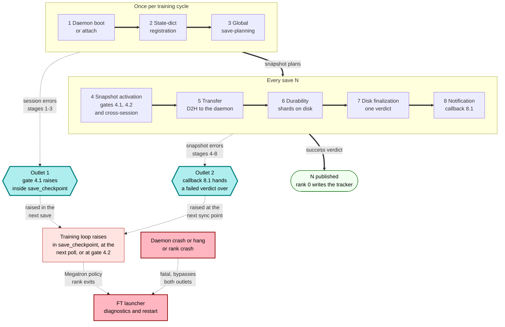
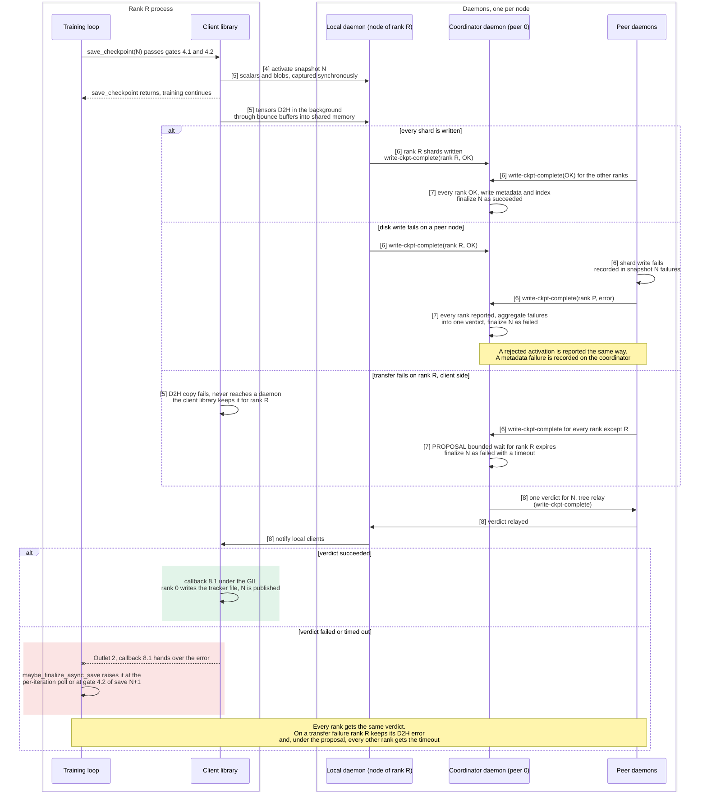
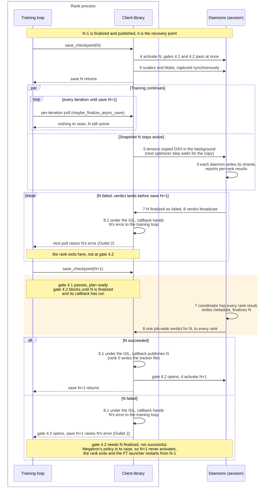
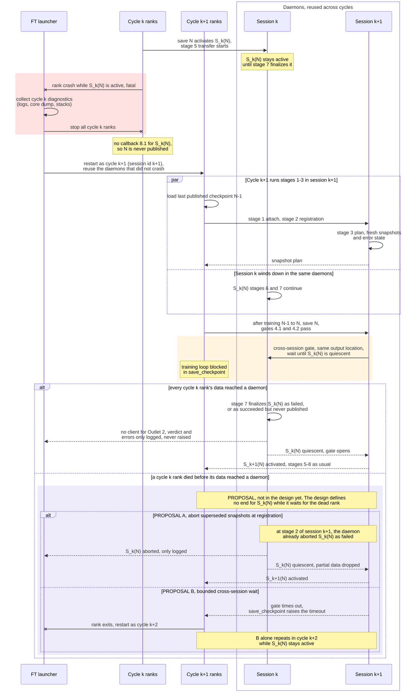
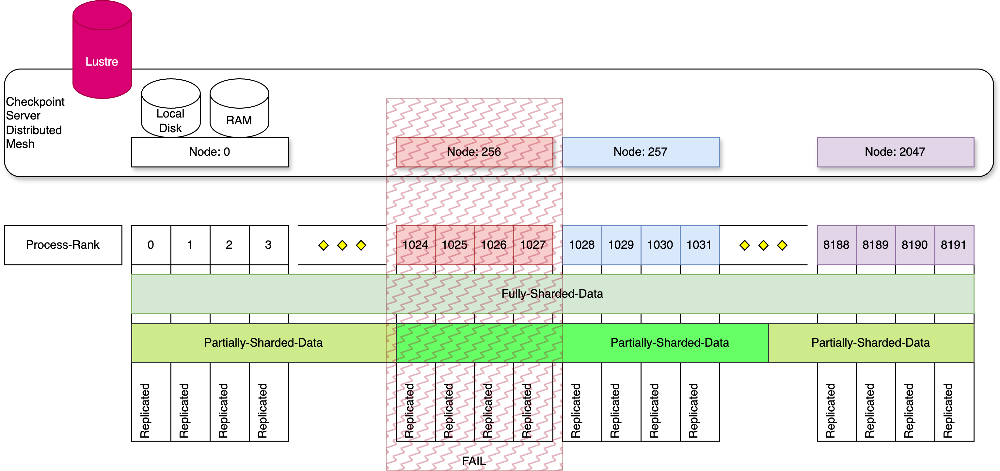
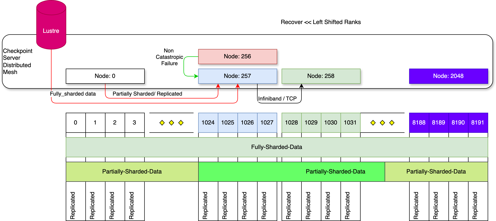
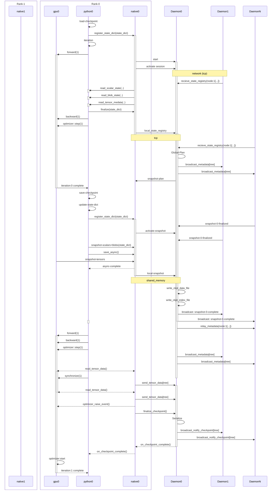

# Design Goals

- Scalability @100K+: Predictable and consistent performance

- Speed-of-Light Recovery
  - Enable the fastest path of recovery for happy-path scenarios without sacrificing recovery for other types of failures (no trade-offs)
    For eg:
    - Recovery can be catagorized into:
      - Transient: No HW resource swaps needed
      - Catastrophic : Requires recovering with a new set of GPU/Host nodes
    - Transient/Catastrophic jobs can be further categorized into
      - Low resource utilization
      - High resource utilization
    - The goal involves either auto-detecting and provding hooks for the user to select the appropriate mechanism that provides the SOL path given the resource constraints.
  - Minimizing and efficient utilization of resources
  - Fine-Grained synchronization support

- Workload Generality
  - Complex optimizers (scaling state-dictionary/sharding-metadata size and complexity)
  - Multiple tenant and models (Post-training)
  - Inference workload applicability
    - Disaggregated Prefill/decode
    - Avoid strong pytorch dependency
  - Auto-Quantization/Dequantization for checkpointing

- Infrastructure generality, redundancy and resiliency
  - Tunable policies for Mem-IO / Network-IO / Disk-IO preferences
    - There are cases where network-io maybe faster than disk-io
    - Disk might not be big enough
    - Not enough RAM
  - Redundancy by using multiple storage policies ()
  - Multiple network backends for data interchange (NVLink/Infiniband/TCP)

# API Surface

The sequencing of checkpointing and the API surface is divided into 3 main areas

1. State-Dictionary Registration
2. Save: Snapshot capture (Tensor, Blobs, Scalars etc) and durability guarantees
3. Load: Recover from snapshots

## State Registration

### Preface: Pytorch/Megatron-LM : State-Dictionary

Pytorch and megatron apis follow the model of preparing state-dictionary completely outside the visibility of the checkpointing module and have a single api to hand over that state-dictinary.

This can often lead to the checkpointing module surfacing errors that could be traced back to the invalid or erroneous state-dictionary preparation.

- State dictionary construction is very janky. No schema
- Optimizer frequently rely on trampling over child-optimizer states thus causing confusion
- State dictionary goes through multiple rounds of filtering and transformations in checkpointing code leading to unclear contract between Modules and checkpointing

### Design Goals

- Allow for "fill-in" state-dictionary preparation rather than a "hand-over"
- easy to use api-wrappers for python (megatron-lm, pytorch) based state-dictionary registration for smoother integration.
  - Support pytorch/megatron-lm bridges for DTensor, ShardedTensor metadata extraction.
- Flexibility for future (possibly inference) based usage to populate a state-tree in-place directly from c++ or other frontend languages and register the supported types.
  - Type-safe and faster
  - Better construction and more meaninful errors around collisions, duplications etc
- Future work: Capture Full fidelity tensor layout (sharding + replication) information.

```python
# First Registration
# Happens after the load-checkpoint call
root = nvrx_checkpointing.checkpoint.model_state.create_root()
root.register_state_dict(state_dict)
# Intended to signify that the state-dictionary structure wont change
root.finalize_registry()
# Finalize also warms up the SHMem-Queue and initiates a sync across all the ranks to infer the dedup-ing of replicated tensors.

...

# Update State-dictionary

# Happens as part of save_checkpoint
# Captures the blobs and update the scalar values synchronously
# Tensors are captured asynchronously
root.register_state_dict(state_dict)
```

## Save Checkpoint: Megatron

```python
# args compatible with save_checkpoint fn
def _save_checkpoint_impl(save_args: SaveCheckpointArgs, started_at_ns: int) -> None:
  # Wait for previous checkpoint to complete
    maybe_finalize_async_save(blocking=True)

  # update rng-state-blobs and hyper-parameters in state-dict

  # register state-dictionary and capture blobs + scalars
  root = register_state_dict(state_dict, iteration)

  # async scalar, blob capture + async snapshot (tensor) capture and durability
  root.save_async(iteration, checkpoint_dir)

  # wait for scalar, blob capture to complete. Tensor snapshot continues ...
  root.wait_for_deferred_save()

  # For sync-checkpointing. Wait for everything to complete
  if not getattr(args, "async_save", False):
      checkpoint.wait_for_ckpt_finalize(_SESSION_ID, iteration)
      finalize_fn()

  # For async checkpointing. oncomplete finalize-fn
  else:
      future = _get_executor().submit(checkpoint.wait_for_ckpt_finalize, _SESSION_ID, iteration)
      _pending = _PendingSave(future, finalize_fn)

```

## Load Checkpoint (TBD)

## Future API Changes

- python async/await pattern for async apis
  - fine-grained async futures for D2H, Mem-Snapshot, Durable-Snapshot etc
- Async Load-Checkpoint
  - Allow construction of data-loaders, cuda-graphs etc in parallel

## TODO : Cleanups

- namespaces
- packaging
- daemon vs session : note on why sessions are needed
- Bugfix : for session overlap

## TODO : Assumptions

- Daemon relies on megatron to validate the checkpoint file
- Shared - memory - Daemon
  - Add a Time sequence diagram for daemon and shared-memory

1. Daemon opens the shm file (listener)
   1.1 . shm file is already exists. it'll reinitialize it
   1.2 - Any producer thats still writing to the old file will error

# Daemon

The daemon operates as primarily a manager of:

1. Session : Captures all state that corresponds to a training-job
2. Lifetime Management : Managing lifetimes of the module and the individual sessions
3. Messaging Infra: (Shared-Memory, Web-Service etc) : Relays requests/data to session(s) or processes lifetime management requests

## Session

The session manages state that corresponds to a specific training-job. There are two main components of the state

1. Session-State : Computed once and applies to the entire session
2. Snapshot-State : Applies to each individual snapshot within a session

### Session-State

The following are the most important session state

1. The local registry (per-local-rank)
2. Global Registry. A full detailed plan that knows the locations of each state-dictionary item as well as their replication or shard locations.
3. Deduped Local Registries (per-local-rank): This is also used as the snapshot plan and consists of rank-assignment to avoid duplicate snapshoting and disk-persistence for checkpoint state
4. Snapshots : Each snapshot further has its own state but the session maintains all the snapshots available within a session.
   1. Snapshots can be evicted to conserve memory
   2. Snapshots can be loaded (or preloaded) from disk as needed

A Session is considered initialized and valid once it has recieved the global registry from the coordinator (or merged all local registries on the coordinator) and computed the local-registries for its local-ranks
Any error during the session initialization will prevent a async-save from the training job and will be bubbled up during the first save request.

### Snapshot-State

A snapshot can be under-construction or finalized. Once finalize the snapshot state is considered frozen and not modified.
Snapshots can be evicted by the Session if the server starts running out of memory or based on user preference on how many active snapshots to maintain
Partial snapshots arent considered reusable. The following state is maintained in the snapshot

Once fine

1. Snapshot Registry
2. Byte-Storage
3.

# Lifecycle Management (Daemon)

The section covers mainly the daemon-module where the main processing of state-dictionary, planning and checkpointing tasks are happening.

The daemon can operate in 2 life-cycle modes

1. Self-managed
2. Externally launched and managed

The module itself can be instantiated in 2 ways.

1. In-Proc mode (always self-managed)
2. Out-of-proc mode: Both Self-managed and external managed.

## Self-Managed

The primary mechanism to assist the self-managed lifecyle is via <mark>(TODO: better name)references</mark>. which come in 3 flavors

1. Self-References / In-Proc references
2. Local-Process Reference
3. Remote Process Reference.

These references keep the daemon process alive and assist with the startup sequence.
The daemon is auto-launched when the first-reference is acquired and gracefully spins down when the last-reference is released (after a configurable inactivity timeout)

### Startup Sequence

- The first reference in a process pings the server.
- A boot is requested if its unable to ping the server
- Potentially multiple requests can be made to bootup the server from multiple threads
- Each startup request tries to listen to the port which acts as a gate.
- The first one wins. The rest gracefully cede.
- A reference is acquired on the newly started server / already-existing server which keeps it alive until its released

### Spin-Down

- The daemon keeps a list of all references.
- As long as atleast one in-proc reference is alive it does nothing.
- When all in-proc references are released it checks the local-proc references
- Local-proc references

### Keep-Alive

## In-proc mode (No ft-launcher integration needed)

The in-proc mode implies that the daemon will be instantiated inside one of the N-local ranks in the training process and its lifetime is bound by the training process and hence the lifecycle is always self-managed.

This is meant to simplify the lifecycle management for scenarios that dont require fault-tolerance or quick recovery (mainly dev scenarios) and hence it requires no additional management.

The daemon holds the rank-process its instantiated in, from exiting, especially if its a coordinator daemon for the job and keeps the process alive unless its ready to wind-down in case of a regular spin-down.
This is part of the regular

## Out-of-proc mode : FT-Launcher Integration (Fault-Tolerance)

The ft-launcher is component responsible for tracking the individual rank processes and restarting in case of errors or exceptions happening on any of the ranks.
The section describes extension of the ft-launcher's umbrella to include tracking and crash-diagnostics on the daemon.
While the daemon does provide auto-start/spin-down behavior to avoid requiring a separate pre-launch mechanism the ft-launcher integration forces manual lifetime management by launching it manually (epilogue to training jobs) as well as spinning down manually (prologue)

In an ideal world we dont expect the daemon to ever crash or exit during a training run so all unexpected process terminations are considered fatal and invoke the fault-diagnostics as well as fault-recovery routines, causing the training to restart.

Here's a consolidated list of behaviors when it comes to ft-launcher and daemon interaction

- Cold start: Daemon to be launched by ft-launcher before training-jobs-processes
- Recovery start : Daemon is launched if not already present
  - The previous daemon process from earlier is continued to be used across all nodes.
  - The cycle id is used as a session-id for the daemon which insulate the workflow of this cycle from any partial workflow state from last cycle
  - This mechanism in future will be used to provide quick-load-checkpoint by using the in-memory snapshot from previous session.

- Logging: Redirect to itself.
  - ft-launcher launches daemon with cli-args (<mark>TODO</mark>)to capture its logging
  - One consolidated log per cycle
  - On a restart if the daemon is reused ft-launcher handles redirecting the logs to a new cycle without the need to change daemon log outputs

- Daemon Critical Fault Handling : Collect diagnostic logs and restart
  - All Daemon crashes are considered unexpected bugs that need fixing or handling.
  - Non-crashed daemons are reused. (New session-id insulates the session from last-session state)
    - <mark>TODO</mark> : Should we terminate all daemons ??. This will handicap fast-recovery
  - Diagnostics include daemon coredump (if applicable) and logs.
  - Also includes daemon being unresponsive or hanged (stack trace if hanged)

# Resiliency and Error Handling

Two principles shape how failures are handled:

1. **The daemon never intentionally crashes or raises.** It records each failure on the session or snapshot that the failure belongs to and reports it to the clients. A daemon crash is always a bug and is handled as a fatal fault (see [FT-launcher integration](#out-of-proc-mode--ft-launcher-integration-fault-tolerance)).
2. **The client API is almost entirely asynchronous.** Background work never raises into the training loop directly. Its errors travel through two _outlets_ and are raised only at synchronous points of the training loop.

## Stages and error outlets

A _cycle_ is one launch of the training ranks, and every FT-launcher restart starts the next cycle. Each cycle has its own session in the daemon set (one daemon per node), and the session id is the cycle id. One daemon, the _coordinator_ (peer 0), builds the global plan and aggregates snapshot results for the whole job. A cycle goes through these stages:

| Stage                      | What happens                                                                                                                                                                                                                                                                                                                                                                           | When           | Training loop                | Errors surface at |
| -------------------------- | -------------------------------------------------------------------------------------------------------------------------------------------------------------------------------------------------------------------------------------------------------------------------------------------------------------------------------------------------------------------------------------- | -------------- | ---------------------------- | ----------------- |
| 1. Daemon boot or attach   | The client library attaches to the node's daemon. The FT launcher starts the daemon, or the client starts it in self-managed mode.                                                                                                                                                                                                                                                     | Once per cycle | Async                        | Outlet 1          |
| 2. State-dict registration | Each rank sends its local registry to its daemon, which forwards it to the coordinator.                                                                                                                                                                                                                                                                                                | Once per cycle | Async                        | Outlet 1          |
| 3. Global save-planning    | The coordinator merges every registry into the global plan and broadcasts it, and each daemon derives the deduplicated snapshot plans of its ranks.                                                                                                                                                                                                                                    | Once per cycle | Background                   | Outlet 1          |
| 4. Snapshot activation     | Gate 4.1 waits for the rank's snapshot plan and raises any session error (Outlet 1). Gate 4.2 waits until the previous snapshot is finalized and its callback has run, and raises that snapshot's error, if any (Outlet 2). The cross-session gate waits until the active snapshots of other sessions on the same output location are _quiescent_: finalized, with no write in flight. | Every save     | Blocks                       | Outlet 2          |
| 5. Transfer                | Scalars and blobs are captured synchronously. Tensors are copied device-to-host (D2H) in the background into the daemon's shared memory, and the next optimizer step waits on an event until the copy is done.                                                                                                                                                                         | Every save     | Blocks for scalars and blobs | Outlet 2          |
| 6. Durability              | Each daemon writes its ranks' shards and reports each rank's result to the coordinator.                                                                                                                                                                                                                                                                                                | Every save     | Async                        | Outlet 2          |
| 7. Disk finalization       | The coordinator waits for every rank's result, writes the metadata, and finalizes the snapshot with one _verdict_: succeeded, or failed with the collected errors.                                                                                                                                                                                                                     | Every save     | Async                        | Outlet 2          |
| 8. Notification            | The coordinator broadcasts the verdict and each daemon notifies its clients. Callback 8.1 takes the GIL and runs the client's finalization routine.                                                                                                                                                                                                                                    | Every save     | Pauses for callback 8.1      | Outlet 2          |



- **Outlet 1, gate 4.1** (synchronous, inside `save_checkpoint`) delivers session errors from stages 1-3. The coordinator records a planning failure on the session and broadcasts it, so every rank raises the same error at its next save.
- **Outlet 2, callback 8.1** (asynchronous) delivers snapshot errors from stages 4-8. Daemons record failures on the snapshot and report them to the coordinator, which aggregates them into the job-wide verdict. Callback 8.1 hands a failed verdict to the training loop, which raises it at its next sync point: the per-iteration poll (`maybe_finalize_async_save`) or gate 4.2 of the next save.
- **Fatal.** A daemon crash or hang, or a rank crash, bypasses both outlets. The FT launcher collects diagnostics and restarts training as the next cycle.

A snapshot is _active_ until stage 7 finalizes it. Only callback 8.1 of a succeeded snapshot _publishes_ it as the checkpoint to resume from (for Megatron, rank 0 writes the latest-checkpoint tracker file). A failed or partial snapshot is never published or reused, so the last published checkpoint stays the recovery point.

## How an error reaches every rank



An error that occurs in or reaches a daemon becomes job-wide: the coordinator aggregates it into the snapshot's verdict, and every rank receives the same error. A planning failure reaches every rank's gate 4.1 the same way. An error that never leaves the client library, such as a D2H failure on rank R, reaches rank R only. The snapshot cannot finalize without rank R's result, and nothing bounds that wait (see [Open questions](#open-questions)).

## Concurrency

### Overlapping snapshots in one session



N-1, N and N+1 denote consecutive saves. Once `save_checkpoint` returns, the tensor copy of stage 5 and stages 6-8 of save N overlap training. When save N+1 starts before snapshot N is finalized, gate 4.2 blocks the training loop until N is finalized and its callback has run. At most one snapshot per session is active, so the failures of N and N+1 never mix.

- **N's verdict arrives first.** On success, the callback publishes N and gate 4.2 passes at once. On failure, the next per-iteration poll raises N's error.
- **Save N+1 arrives first.** Gate 4.2 waits for N. On success, N is published and N+1 activates. On failure, save N+1 raises N's error and N+1 never activates.
- **Policy.** Gate 4.2 requires N to be finalized, not successful. Whether training continues after a failure is the client's policy. Megatron raises, so the rank exits and the FT launcher restarts training from N-1, the last published checkpoint.
- **Synchronous saves** wait for their own callback inside `save_checkpoint`, so they never overlap.

### Overlapping sessions: a new cycle while the previous one winds down



Cycle k crashes while S_k(N), its snapshot of save N, is still active: durability is still running, or the coordinator is still waiting for results from ranks that died. The FT launcher collects cycle k's diagnostics and restarts the ranks as cycle k+1, reusing the daemons that did not crash.

- **Insulation.** Cycle k+1 runs stages 1-3 in its own session k+1, with a fresh plan, snapshots and error state, while session k winds down in the same daemon processes.
- **Recovery point.** No callback runs for S_k(N), so it is never published, and cycle k+1 resumes from N-1.
- **Same output location.** When cycle k+1 repeats save N, gates 4.1 and 4.2 pass, but the new snapshot writes to the same location as S_k(N). The cross-session gate holds its activation until S_k(N) is quiescent.
- **Errors of the old session.** Session k has no client left, so its verdict and errors are only logged and never raised into cycle k+1. The FT launcher redirects a reused daemon's log to the current cycle, so a late verdict of session k lands in cycle k+1's log.
- **Reuse.** Completed snapshots of session k may stay in daemon memory for a future fast load. Partial snapshots are never reused.

### Open questions

- <mark>TODO</mark> **Snapshots that can never finalize.** A snapshot that waits for data that never arrives, from a rank that died or whose D2H copy failed, has no defined end, so it can hold gate 4.2 or the cross-session gate forever. Proposal: when no rank result arrives within a timeout, the coordinator finalizes the snapshot as failed with a timeout verdict that names the missing ranks, and the daemons abort a superseded session's active snapshots when the next cycle's session registers. A timeout on the cross-session gate alone, raised in `save_checkpoint`, turns this into a restart loop.
- <mark>TODO</mark> **Client-side failures.** Proposal: the client library reports a client-side failure (a registration or D2H error, for example) to its daemon whenever the daemon is reachable, so the coordinator fails the plan or the snapshot for every rank at once instead of waiting for input that never arrives.
- <mark>TODO</mark> **Same output location.** Is it the checkpoint root or the per-iteration directory? With the per-iteration directory, only a re-save of the same iteration waits.
- <mark>TODO</mark> **Superseded sessions.** A cycle id alone does not tell a daemon that session k+1 supersedes session k when one daemon serves several jobs. Candidates: a job id plus the cycle id, or a notice from the FT launcher.
- <mark>TODO</mark> **Late logs.** Proposal: every daemon log line carries its session id, so a late verdict of session k in cycle k+1's log is not read as a cycle k+1 error.
- <mark>TODO</mark> **Last save of a run.** No later poll or save exists to raise its error. Proposal: the blocking finalize at the end of training is a third sync point for Outlet 2.
- <mark>TODO</mark> **GIL at gate 4.2.** Callback 8.1 needs the GIL while the training loop waits at gate 4.2. Candidates: the wait releases the GIL, or the gate runs the callback on the waiting thread.

## TODO : Error scenario examples

### Example 1 : Transient Node Failure

### Example 2 : Permanent Node Failure

### Example 3 : Session overlap

See [Overlapping sessions](#overlapping-sessions-a-new-cycle-while-the-previous-one-winds-down).

# Key Components and Code Walkthrough

### In-proc: State-Extraction

- Files
  - checkpoint.h/cpp
  - python/bindings.h/cpp
  - python/torch_bindings.cpp
  - state.h
  - stateserdes.h
  - serdes_utils.h

#### State-Tree

- state.h
  - The in-memory state representation for all the scalars/blobs/tensorshard extracted from state-dictionary
  - Blob + Scalars : Snapshotted during traversal (Includes, RNG State, learning-rate-hyperparametets etc. )
  - TensorShards : Only metadata extracted. D2H Happens asynchronously

#### Python-Interfaces

- python/bindings.h/cpp
  - Python apis registration
  - Python state dictionary traversal. (Periodic quick GIL acquisition and release to avoid stalls)
  - Extract state from state-dictionary (python) into native in-memory tree.
- python/torch_bindings.cpp
  - metadata bridge for pytorch/megatron-lm classes (ShardedTensor/ShardedObjects etc) (TODO: DTensor support)

#### D2H (and TODO: H2D)

- Device Interfacing (non-blocking)
  - Background: Tensor data extraction
    - Temporary (CPU-Mem) Bounce Buffers (`4 * 16Mb` seems sufficient) cap the total CPU memory requirements
    - No additional GPU memory needed
  - Stream/Events for Workload synchronization
- Interfacing with Checkpointing Service
  - Shared memory + sockets

### Snapshot Daemon

- Intended to persist beyond a job (across requeues)
- Multiple simultaneous job/rank sessions. (Separate shmem channel)

- Auto-Start Auto-stop Daemon Service
  - Spin down based on configured inactivity duration
  - Spin up on-demand access from in-proc client thread

- Persistent storage of checkpoints policies
  - In-memory cache (LRU) (No deduplication of replicated/partially sharded tensors)
  - Local-Disk (No deduplication)
  - Network storage (with deduplication)

- Mesh broadcasts and signalling (over separate process group disjoint from workload)
  - Broadcast metadata (local tensor shards)
  - Rendezvous for determining successful checkpoint task completion.

- Allow blocking or non-blocking persistent serialization (local-disk/network-disk) based on workload intent

- Can be configured as a part of nvrx launcher / system-service as needed
  - Perhaps we should just fuse it with the nvrx launcher ?!!

# Workflow: Out-of-proc Checkpointing-Server (Mesh)

Considering a scenario where a workload (typically a training job) consists of some fixed set of GPUs (4 in the diagram below).
Each node will have a singleton process which operates as a mesh-node, part of an overall distributed server mesh.

The node characteristics:

- Low-latency shared memory (numa aware) based data-sharing between Server and rank processes
- Multiple Backing storage
  - In-memory cache
  - Local Disk
  - Network file-system (lustre)
- Async Signalling between Mesh nodes to determine the fully backed up checkpoints.
  - Rendezvous and stall points for guarantees as needed
  - Async event notifications (registered callbacks) to the workload as needed
- Metadata broadcast between mesh nodes for identifying local and remote shards and global locality and replication.



Recovery for the optimal scenario.

The following diagram illustrates a typical fast recovery where a GPU on Node-256 fails but the node itself is alive with its in-memory checkpoint available.
In this case no other model changes to parallelization schemes were made and the job is simply recovering with a hot-spare (Node-2048)

- Ranks[0-1023] have their local checkpoints valid and available in the in-memory cache for fully local and instant recovery.
- The ranks[Prev: 1028-8191] are relocated and left-shifted from the failure index with the devices for Ranks[Prev: 1024-1027] are yanked out.
  - The local checkpointed data contained in the server node (257) (Prev-Rank: 1028, New-Rank: 1024) now corresponds to +4 rank (Prev-Rank: 1032, New-Rank: 1028)
  - The Node(258) (New-Rank:[1028-1031]) pulls its data from Node-257 (New-Rank:[1024-1027]) over the networking layer thereby avoiding the disk
  - Depending on performance characteristics of the remote location (within-rack / across-rack) the mesh-node might decide to either pull its data from a remote-node or a remote-file-system
- The mesh nodes will purge their local-data (LRU cache) as needed with new metadata and local-data checkpoints.



## Workflow: Time sequence



```

```

```

```
