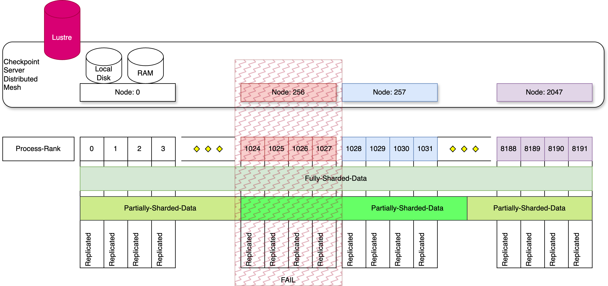
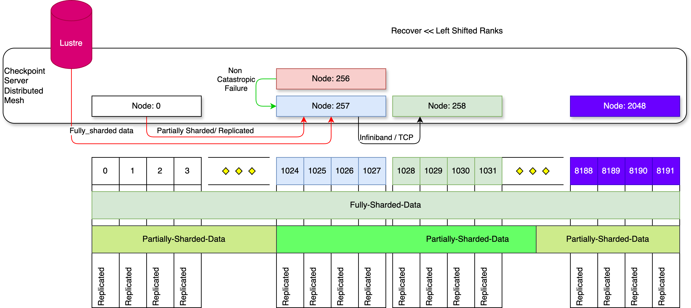
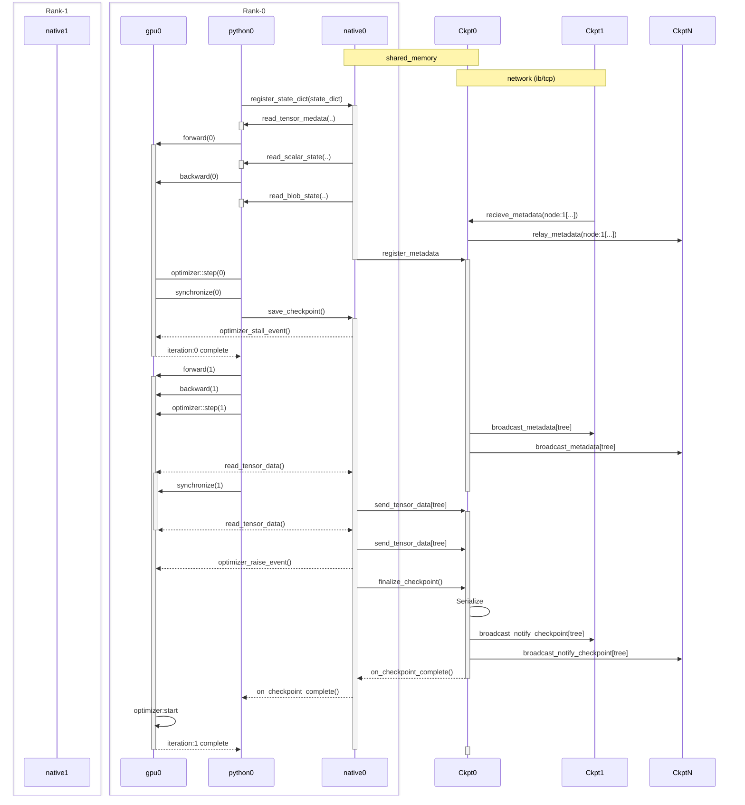
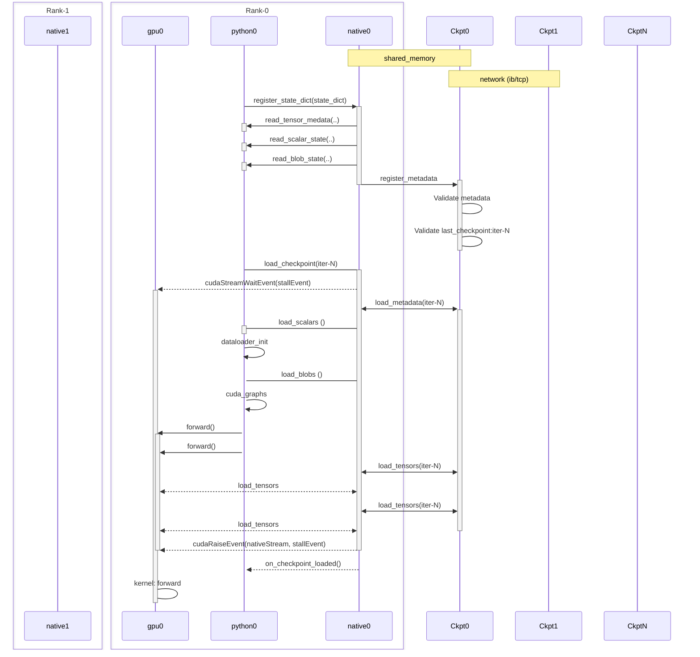

# Design Goals

* Speed-of-Light
  * Make the happy-path faster without regressing the sad-path guarantees and performance
    * for eg: Prefer Mem caching to avoid Network-IO / Disk-IO wherever possible
  * Minimizing and efficient utilization of resources
  * Fine-Grained synchronization support
* Scalability @100K+: Predictable and consistent performance
* Workload Generality
  * Complex optimizers (scaling state-dictionary/sharding-metadata size and complexity)
  * Multiple tenant and models (Post-training)
  * Inference workload applicability
    * Disaggregated Prefill/decode
    * Avoid strong pytorch dependency
  * LPUs ?
* Cluster generality, redundancy and resiliency
  * Tunable policies for Mem-IO / Network-IO / Disk-IO preferences
    * There are cases where network-io maybe faster than disk-io
    * Disk might not be big enough
    * Not enough RAM 
  * Redundancy by using multiple storage policies ()
  * Multiple network backends for data interchange (NVLink/Infiniband/TCP)

# API Surface

## Capturing State Dictionary

```
root = megatron.native.checkpoint.model_state.create_root()
root.register_state_dict(state_dict)
root.finalize_registry()

```
* The simplest case would involve simply registering a complete state_dict that the module traverses to identify the state-tree
  * Type unsafe requires inferring types

<mark>[Future Ideas and concepts]</mark>
* Register state directly with the registry (not go through an intermediate state-dict preparation)
  * Type-safe and faster
  * Better construction and more meaninful errors around collisions, duplications etc
```

layer1 = root.ceate_dict("layer-1")
layer1.register_tensor("", [size])
optim = root.create_dict("adam")
m = optim.create_dict("momentum")
m.register_sharded_dict("foo", [full_size], [shard_range], ...) # Specify local shards

```
* Better expressivity to register sharded information 
    * Potentially : Specifying remote-shards/sharding-expression that avoid the need for metadata-broadcast

```
# Specify sharding expressions
# Avoids the needs for a shard-metadata broadcast
m.register_sharded_dict("foo", 
  [c, hidden_dim], # Global dimensions
  ["size", "aligned_shard_for_rank(size, world_size, rank, 64)"] # Lightweight (Lua??) expressions to compute shard_range across ranks
)
```

## Async Save Checkpoint

```
# root = megatron.native.checkpoint.model_state.create_root()
# Register state and finalize_registry
root.save_async(<checkpoint-dir>) 
root.save(<checpoint-dir>) # synchronous save
```

<mark>[Future Ideas and concepts]</mark>

* Return a `async-promise` to allow native python `async/await` pattern and native `on-complete` chaining and coroutines
* Allow fine-grained orchestration of the ordering for 

```
# Concepts 
await layer1.save_async(<checkpoint-dir>)
evt1.record(stream)

await optim.save_async(<checkpoint-dir>)
evt2.record(stream)

await root.save_async(<checkpoint-dir>)
on_checkpoint_complete()
```

## Async Load Checkpoint

```
root.load(<checkpoint-dir>)
```
* Loads the checkpointed state from the directory 

<mark>[Future Ideas and concepts]</mark>

* Make this async as well
* Return a `async-promise` to allow native python `async/await` pattern and native `on-complete` chaining and coroutines
* Allow fine-grained orchestration of the ordering


## Synchronization

```
# TODO: Refine this

# stalls the python thread until the async-save completes
root.wait_for_deferred_save()

# Injects a stream.wait_event into the default kernel launch stream for the optimizer kernel exec to be queued behind
root.wait_for_save_event(defaultstream)
```
* Minimizes the changes required into the megatron model code.
* Single line stall point 

* TODO : a more expressive and fine-grained (state-data-based) stall
   * Save: Stall invoked before tensor(s) are modified by the model
   * Load: Stall invoked before tensor(s) are read by the model

## Callbacks/Event-Handling

```
root.on_checkpoint_save_complete(checkpoint_save_handler)
```

* TODO : replace with `async/await` (coroutines) based api surface

# Key Components

### In-proc Native thread

  * Python state dictionary traversal. (Periodic quick GIL acquisition and release to avoid stalls) 
  * Device Interfacing (non-blocking)
    * Background: Tensor data extraction
      * Temporary (CPU-Mem) Bounce Buffers (4 * 16Mb seems sufficient) cap the total CPU memory requirements
      * No additional GPU memory needed
    * Stream/Events for Workload synchronization
  * Interfacing with Checkpointing Service
    * Shared memory + sockets

### Out-of-proc Checkpointing-Server

  * Intended to persist beyond a job (across requeues)
  * Multiple simultaneous job/rank sessions. (Separate shmem channel)

  * Auto-Start Auto-stop Daemon Service
    * Spin down based on configured inactivity duration
    * Spin up on-demand access from in-proc client thread 

  * Persistent storage of checkpoints policies
    * In-memory cache (LRU) (No deduplication of replicated/partially sharded tensors)
    * Local-Disk (No deduplication)
    * Network storage (with deduplication)
  
  * Mesh broadcasts and signalling (over separate process group disjoint from workload)
    * Broadcast metadata (local tensor shards)
    * Rendezvous for determining successful checkpoint task completion.
  
  * Allow blocking or non-blocking persistent serialization (local-disk/network-disk) based on workload intent
  
  * Can be configured as a part of nvrx launcher / system-service as needed
    * Perhaps we should just fuse it with the nvrx launcher ?!!

# Workflow: Out-of-proc Checkpointing-Server (Mesh)

Considering a scenario where a workload (typically a training job) consists of some fixed set of GPUs (4 in the diagram below). 
Each node will have a singleton process which operates as a mesh-node, part of an overall distributed server mesh.

The node characteristics:
* Low-latency shared memory (numa aware) based data-sharing between Server and rank processes
* Multiple Backing storage
  * In-memory cache
  * Local Disk 
  * Network file-system (lustre)
* Async Signalling between Mesh nodes to determine the fully backed up checkpoints.
  * Rendezvous and stall points for guarantees as needed
  * Async event notifications (registered callbacks) to the workload as needed
* Metadata broadcast between mesh nodes for identifying local and remote shards and global locality and replication.




Recovery for the optimal scenario.

The following diagram illustrates a typical fast recovery where a GPU on Node-256 fails but the node itself is alive with its in-memory checkpoint available.
In this case no other model changes to parallelization schemes were made and the job is simply recovering with a hot-spare (Node-2048)
* Ranks[0-1023] have their local checkpoints valid and available in the in-memory cache for fully local and instant recovery.
* The ranks[Prev: 1028-8191] are relocated and left-shifted from the failure index with the devices for Ranks[Prev: 1024-1027] are yanked out.
  * The local checkpointed data contained in the server node (257) (Prev-Rank: 1028, New-Rank: 1024) now corresponds to +4 rank (Prev-Rank: 1032, New-Rank: 1028)
  * The Node(258) (New-Rank:[1028-1031]) pulls its data from Node-257 (New-Rank:[1024-1027]) over the networking layer thereby avoiding the disk
  * Depending on performance characteristics of the remote location (within-rack / across-rack) the mesh-node might decide to either pull its data from a remote-node or a remote-file-system
* The mesh nodes will purge their local-data (LRU cache) as needed with new metadata and local-data checkpoints.




## Workflow: Time sequence 


## Load (Recovery)



## Open Question

* How to get complete list of peers for the distributed-server-mesh with Slurm-Job-Arrays ?
* How to capture Rng-States ? Understand how it works today with async-checkpointing ?
* 


## Discussion Notes (2026-02-04)


## Review Comments


