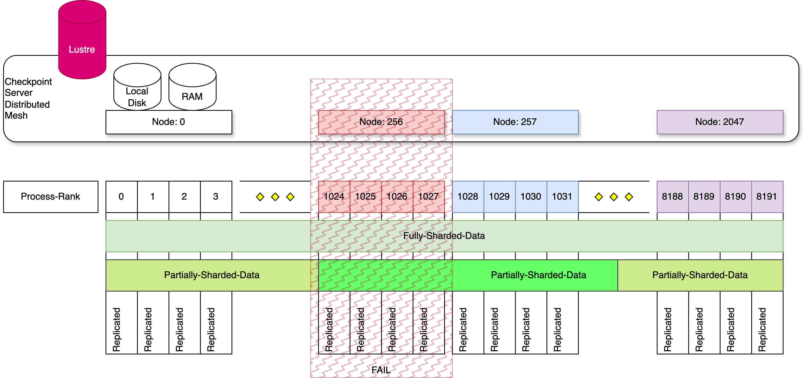
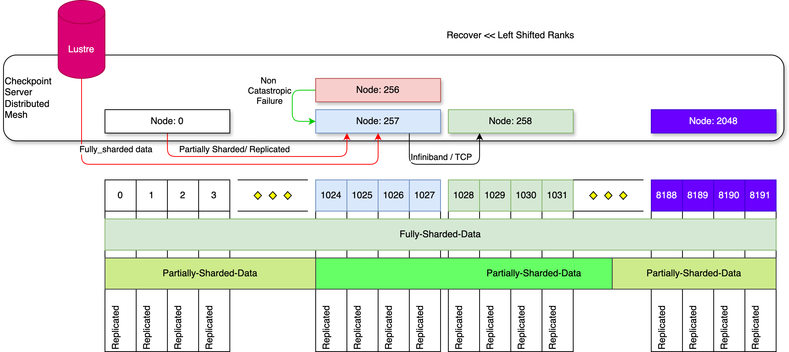
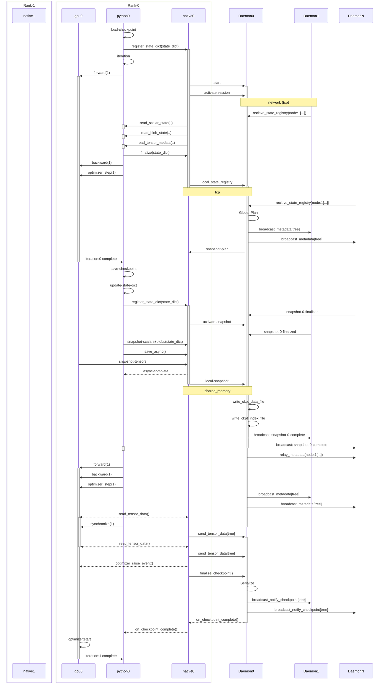

# Design Goals

- Scalability @100K+: Predictable and consistent performance

- Speed-of-Light Recovery
  - Enable the fastest path of recovery for happy-path scenarios without sacrificing recovery for other types of failures (no trade-offs)
    For eg:
    - Recovery can be catagorized into:
      - Transient: No HW resource swaps needed
      - Catastrophic : Requires recovering with a new set of GPU/Host nodes
    - Transient/Catastrophic jobs can be further categorized into
      - Low resource utilization
      - High resource utilization
    - The goal involves either auto-detecting and provding hooks for the user to select the appropriate mechanism that provides the SOL path given the resource constraints.
  - Minimizing and efficient utilization of resources
  - Fine-Grained synchronization support

- Workload Generality
  - Complex optimizers (scaling state-dictionary/sharding-metadata size and complexity)
  - Multiple tenant and models (Post-training)
  - Inference workload applicability
    - Disaggregated Prefill/decode
    - Avoid strong pytorch dependency
  - Auto-Quantization/Dequantization for checkpointing

- Infrastructure generality, redundancy and resiliency
  - Tunable policies for Mem-IO / Network-IO / Disk-IO preferences
    - There are cases where network-io maybe faster than disk-io
    - Disk might not be big enough
    - Not enough RAM
  - Redundancy by using multiple storage policies ()
  - Multiple network backends for data interchange (NVLink/Infiniband/TCP)

# API Surface

The sequencing of checkpointing and the API surface is divided into 3 main areas

1. State-Dictionary Registration
2. Save: Snapshot capture (Tensor, Blobs, Scalars etc) and durability guarantees
3. Load: Recover from snapshots

## State Registration

### Preface: Pytorch/Megatron-LM : State-Dictionary

Pytorch and megatron apis follow the model of preparing state-dictionary completely outside the visibility of the checkpointing module and have a single api to hand over that state-dictinary.

This can often lead to the checkpointing module surfacing errors that could be traced back to the invalid or erroneous state-dictionary preparation.

- State dictionary construction is very janky. No schema
- Optimizer frequently rely on trampling over child-optimizer states thus causing confusion
- State dictionary goes through multiple rounds of filtering and transformations in checkpointing code leading to unclear contract between Modules and checkpointing

### Design Goals

- Allow for "fill-in" state-dictionary preparation rather than a "hand-over"
- easy to use api-wrappers for python (megatron-lm, pytorch) based state-dictionary registration for smoother integration.
  - Support pytorch/megatron-lm bridges for DTensor, ShardedTensor metadata extraction.
- Flexibility for future (possibly inference) based usage to populate a state-tree in-place directly from c++ or other frontend languages and register the supported types.
  - Type-safe and faster
  - Better construction and more meaninful errors around collisions, duplications etc
- Future work: Capture Full fidelity tensor layout (sharding + replication) information.

```python
# First Registration
# Happens after the load-checkpoint call
root = nvrx_checkpointing.checkpoint.model_state.create_root()
root.register_state_dict(state_dict)
# Intended to signify that the state-dictionary structure wont change
root.finalize_registry()
# Finalize also warms up the SHMem-Queue and initiates a sync across all the ranks to infer the dedup-ing of replicated tensors.

...

# Update State-dictionary

# Happens as part of save_checkpoint
# Captures the blobs and update the scalar values synchronously
# Tensors are captured asynchronously
root.register_state_dict(state_dict)
```

## Save Checkpoint: Megatron

```python
# args compatible with save_checkpoint fn
def _save_checkpoint_impl(save_args: SaveCheckpointArgs, started_at_ns: int) -> None:
  # Wait for previous checkpoint to complete
    maybe_finalize_async_save(blocking=True)

  # update rng-state-blobs and hyper-parameters in state-dict

  # register state-dictionary and capture blobs + scalars
  root = register_state_dict(state_dict, iteration)

  # async scalar, blob capture + async snapshot (tensor) capture and durability
  root.save_async(iteration, checkpoint_dir)

  # wait for scalar, blob capture to complete. Tensor snapshot continues ...
  root.wait_for_deferred_save()

  # For sync-checkpointing. Wait for everything to complete
  if not getattr(args, "async_save", False):
      checkpoint.wait_for_ckpt_finalize(_SESSION_ID, iteration)
      finalize_fn()

  # For async checkpointing. oncomplete finalize-fn
  else:
      future = _get_executor().submit(checkpoint.wait_for_ckpt_finalize, _SESSION_ID, iteration)
      _pending = _PendingSave(future, finalize_fn)

```

## Load Checkpoint (TBD)

## Future API Changes

- python async/await pattern for async apis
  - fine-grained async futures for D2H, Mem-Snapshot, Durable-Snapshot etc
- Async Load-Checkpoint
  - Allow construction of data-loaders, cuda-graphs etc in parallel

## TODO :

- namespace

## TODO : Error Cases GO over resiliency

- Sessions
- Error scenarios
  - During planning
  - During snapshotting

## TODO : Assumptions

- Daemon is always restarted
- Daemon relies on megatron to validate the checkpoint file
-
- Shared - memory - Daemon
  - Add a Time sequence diagram for daemon and shared-memory

1. Daemon opens the shm file (listener)
   1.1 . shm file is already exists. it'll reinitialize it
   1.2 - Any producer thats still writing to the old file will error
2.

# TODO : Logging and FT-Launcher integration

1. Daemon to launched by ft-launcher

- One consolidate log per cycle
  - All logs go into ft-launcher logs
  - How do training-workers redirect their logs ?
    - stdout/stderr of workers is redirect the training pipe

- Should the daemon cause training process to die
  - Tentatively yes. (Need confirmation from ADLR/Mcore/others if thsis is a no and a redesign)

- ## Core-dump traces

1. Handling of restarts without Daemon kills (Multiple sessions)

2. Logs redirects

- OTel logging ?
-

# Key Components and Code Walkthrough

### In-proc: State-Extraction

- Files
  - checkpoint.h/cpp
  - python/bindings.h/cpp
  - python/torch_bindings.cpp
  - state.h
  - stateserdes.h
  - serdes_utils.h

#### State-Tree

- state.h
  - The in-memory state representation for all the scalars/blobs/tensorshard extracted from state-dictionary
  - Blob + Scalars : Snapshotted during traversal (Includes, RNG State, learning-rate-hyperparametets etc. )
  - TensorShards : Only metadata extracted. D2H Happens asynchronously

#### Python-Interfaces

- python/bindings.h/cpp
  - Python apis registration
  - Python state dictionary traversal. (Periodic quick GIL acquisition and release to avoid stalls)
  - Extract state from state-dictionary (python) into native in-memory tree.
- python/torch_bindings.cpp
  - metadata bridge for pytorch/megatron-lm classes (ShardedTensor/ShardedObjects etc) (TODO: DTensor support)

#### D2H (and TODO: H2D)

- Device Interfacing (non-blocking)
  - Background: Tensor data extraction
    - Temporary (CPU-Mem) Bounce Buffers (`4 * 16Mb` seems sufficient) cap the total CPU memory requirements
    - No additional GPU memory needed
  - Stream/Events for Workload synchronization
- Interfacing with Checkpointing Service
  - Shared memory + sockets

### Snapshot Daemon

- Intended to persist beyond a job (across requeues)
- Multiple simultaneous job/rank sessions. (Separate shmem channel)

- Auto-Start Auto-stop Daemon Service
  - Spin down based on configured inactivity duration
  - Spin up on-demand access from in-proc client thread

- Persistent storage of checkpoints policies
  - In-memory cache (LRU) (No deduplication of replicated/partially sharded tensors)
  - Local-Disk (No deduplication)
  - Network storage (with deduplication)

- Mesh broadcasts and signalling (over separate process group disjoint from workload)
  - Broadcast metadata (local tensor shards)
  - Rendezvous for determining successful checkpoint task completion.

- Allow blocking or non-blocking persistent serialization (local-disk/network-disk) based on workload intent

- Can be configured as a part of nvrx launcher / system-service as needed
  - Perhaps we should just fuse it with the nvrx launcher ?!!

# Workflow: Out-of-proc Checkpointing-Server (Mesh)

Considering a scenario where a workload (typically a training job) consists of some fixed set of GPUs (4 in the diagram below).
Each node will have a singleton process which operates as a mesh-node, part of an overall distributed server mesh.

The node characteristics:

- Low-latency shared memory (numa aware) based data-sharing between Server and rank processes
- Multiple Backing storage
  - In-memory cache
  - Local Disk
  - Network file-system (lustre)
- Async Signalling between Mesh nodes to determine the fully backed up checkpoints.
  - Rendezvous and stall points for guarantees as needed
  - Async event notifications (registered callbacks) to the workload as needed
- Metadata broadcast between mesh nodes for identifying local and remote shards and global locality and replication.



Recovery for the optimal scenario.

The following diagram illustrates a typical fast recovery where a GPU on Node-256 fails but the node itself is alive with its in-memory checkpoint available.
In this case no other model changes to parallelization schemes were made and the job is simply recovering with a hot-spare (Node-2048)

- Ranks[0-1023] have their local checkpoints valid and available in the in-memory cache for fully local and instant recovery.
- The ranks[Prev: 1028-8191] are relocated and left-shifted from the failure index with the devices for Ranks[Prev: 1024-1027] are yanked out.
  - The local checkpointed data contained in the server node (257) (Prev-Rank: 1028, New-Rank: 1024) now corresponds to +4 rank (Prev-Rank: 1032, New-Rank: 1028)
  - The Node(258) (New-Rank:[1028-1031]) pulls its data from Node-257 (New-Rank:[1024-1027]) over the networking layer thereby avoiding the disk
  - Depending on performance characteristics of the remote location (within-rack / across-rack) the mesh-node might decide to either pull its data from a remote-node or a remote-file-system
- The mesh nodes will purge their local-data (LRU cache) as needed with new metadata and local-data checkpoints.



## Workflow: Time sequence



```

```

```

```
